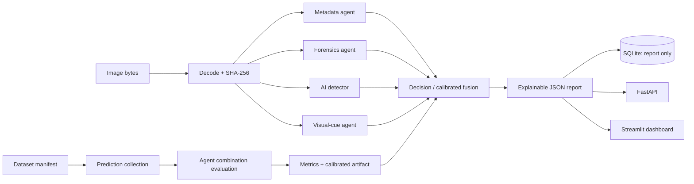

# System architecture

The runtime graph is implemented with LangGraph and is intentionally simple and
inspectable: metadata → forensic cues → configured image classifier → visual cues →
decision. An agent error is represented explicitly and logged; it is not silently
converted into a negative prediction. The decision node abstains unless it has a
calibrated fusion artifact.

## Agent contracts

| Agent | Method | Interpretation |
|---|---|---|
| Metadata | EXIF fields, capture timestamp, camera identifiers, GPS-presence check | Completeness features, not authenticity. Exact GPS is not retained. |
| Forensics | JPEG recompression difference, 8×8 boundary contrast, Laplacian residual variation | Exploratory statistics; no manipulation likelihood is claimed. |
| AI detector | Configured Hugging Face image classifier | Three-class probability only after training with `real`, `ai_generated`, and `ai_edited` labels. |
| Visual cues | Tile-level luminance, edge, and texture summaries | Low-level features; generic shadow/reflection claims are not inferred. |
| Decision | Logistic-regression fusion plus sigmoid calibration on validation data | Estimates the dataset label target (AI generated/edited vs real), not fraud or intent. |

The agent graph can produce a useful report before model training. In that state, the
AI detector and fusion agent abstain. Handcrafted cues remain available as raw features
for benchmark collection but are never averaged into a pseudo-probability.

## Persistence and privacy

SQLite stores JSON analysis reports and image hashes, never uploaded image bytes. Reports
can include filenames and EXIF metadata; use public, appropriately licensed benchmark
images. Avoid uploading personal claim photos. The prototype is not a production
insurance decision service.
